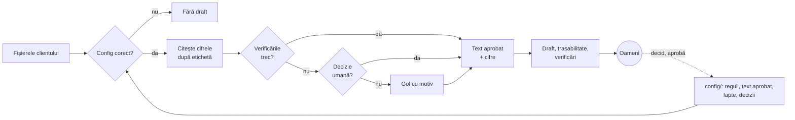

# Automatizarea SFCR pentru Asigurări Carpați

**Către:** Mihai Stoica, Director financiar, Asigurări Carpați S.A.; CTO, BlueberryX

**De la:** Teodor-Vasile Constantin | **Data:** 26.10.2026

**Întrebarea Consiliului:** "Putem avea încredere într-o mașină pentru un raport trimis la ASF și ce e nevoie pentru asta?"

## 1. Răspunsul

Da, dacă programul caută și verifică, iar oamenii scriu și decid. Programul ia cifrele din registru, le verifică și le pune în textul aprobat de oameni. Singur scrie doar direcția schimbării ("în scădere cu 2,1 %") și golul [de completat: motiv]. Alegerea între surse, confirmarea faptelor și aprobarea rămân la oameni. Puteți semna când fiecare cifră are o sursă, fiecare verificare picată are o decizie scrisă și fiecare gol e completat.

## 2. Structura problemei

```
SFCR corect, în fiecare an, fără autori
├── Găsește cifrele ....... greșește când registrul se schimbă
├── Verifică cifrele ...... greșește când o valoare veche pare nouă
├── Ține textul corect .... greșește când rămâne direcția veche
├── Deciziile oamenilor ... greșește când se alege fără urmă
└── Rulează fără autori ... greșește când regulile nu sunt în config
```

Cel mai mare risc e rularea fără autori: anul viitor nu mai suntem acolo să explicăm. Codul trebuie să fie simplu, iar config-ul și mai simplu, ca oricine vine nou să-l înțeleagă singur.

## 3. Designul sistemului



**Drumul datelor.** Programul citește doar sursele din config și doar foile vizibile; pe cele ascunse le semnalează. Textul stă în șabloane aprobate de oameni, cu cine le-a aprobat și când. Programul completează doar cifre, ani și direcții și alege între variante de propoziții scrise de oameni. Deocamdată output-ul acoperă secțiunea E. Aprobarea e legată de text printr-o amprentă: orice modificare după aprobare readuce marcajul de neaprobat.

**Registrul făcut de altcineva.** În cod și în config nu există adrese de celule. Cifra se caută după etichetă, în foaia așteptată și în coloana "an curent", iar unitatea se citește din antet. O etichetă lipsă sau dublă ori o celulă goală dau gol cu motiv. Relațiile prind restul: nivelurile dau totalul, modulele dau SCR.

**Două surse care nu se potrivesc.** Programul nu alege. Aplică doar o decizie din config cu sursă, motiv, cine a propus, cine a aprobat, când și exact valorile în conflict; altfel lasă gol. Exemplu: rata din registrul 2025 e 187,4 %, ca în 2024, dar calculul dă 197,4 %, așa că rămâne [de completat] până la o decizie. O cifră nenulă identică cu cea de anul trecut e tratată tot ca un conflict: așa se prinde orice cifră completată cu valoarea veche. O cifră verificată față de o cifră aflată în conflict devine și ea gol.

**"Creșterea" de anul trecut.** Direcția se calculează din cifre și apare doar dacă valorile afișate diferă. Cauza apare doar dacă un document o susține, cu aceeași direcție, iar registrul arată la fel: riscul de piață chiar a scăzut. Nota actuarială leagă scăderea SCR de riscul de piață, deci cauza intră; fraza despre reasigurare iese.

**Unde decid oamenii.** În config/, deci și în git: decizii, fapte confirmate (document, pagină, citat), șabloane și aprobarea lor.

## 4. Rolul AI

Programul nu folosește niciun LLM. Orice schimbare e validată de oameni: textul nu e generat, iar cifrele sunt completate automat doar din surse existente. Programul are voie să aleagă cuvinte dintr-o listă prestabilită, în funcție de cifre ("în creștere", "în scădere"), și nimic altceva legat de text. În afara raportului, un model poate propune reformulări de șablon sau denumiri alternative de etichete, pe care un om le aprobă.

**Regula pe care aș apăra-o în fața ASF:** orice cuvânt din raport vine dintr-un șablon aprobat de un om sau dintr-o cifră ori un fapt cu sursă verificată.

**Exemplul care m-ar face să o schimb:** un model care doar sugerează unde se află o etichetă negăsită, dacă trece testele de mutație fără nicio cifră greșită în text. L-aș folosi la căutare, niciodată la scris.

## 5. Estimări

**Ce se schimbă** (numărat pe materiale): 34 din 35 de cifre și toate cele 14 mențiuni de an. Din 32 de propoziții, 19 își schimbă doar cifrele. Celelalte 13 cer atenție: 3 își schimbă sensul, 7 devin goluri sau conflicte, 3 cer confirmare umană. Riscul stă în ele, iar acolo un gol e mai bun decât o cifră sau o frază greșită.

**Ore.** Azi, presupunând că lucrează doar pe raport: 3 oameni × 6 săptămâni × 40 h ≈ 720 h pe an. Rămân circa 120 h: 30 pentru goluri și conflicte, 10 pentru fapte, 50 pentru revizuire, 20 pentru config și 10 pentru aprobări. Economia e de circa 600 h pe an. În primul an se adaugă 2-3 săptămâni de configurare.

**Cost.** Ipoteză: o cifră greșită cere 80-240 h de corectare și retrimitere, adică 12.000-60.000 lei la 150-250 lei/h, plus întrebările ASF și riscul unei sancțiuni. Un gol costă o oră. De aceea golul e preferat, iar pragul la teste e zero cifre greșite.

## 6. Prioritizare: patru săptămâni

- Săptămâna 1: construiesc cititorul, verificările și trasabilitatea.
- Săptămâna 2: lucrez la config și la șablonul pentru E.
- Săptămâna 3: restul șabloanelor, A-D.
- Săptămâna 4: finisez programul și îl rulez pe date reale, alături de echipă.

**Ce rămâne manual:** deciziile, faptele din procesele-verbale scanate, revizuirea și aprobarea.

**Ce refuz să livrez:** cifra de anul trecut în locul celei de anul acesta, alegerea automată în tăcere între surse, textul compus de program sau de un model și formulările de la alte companii.

Ordinea urmează riscul: întâi ce poate produce o cifră greșită, apoi o afirmație fără acoperire, apoi restul textului.

## 7. Dovada

Testele rulează cu o comandă, fără mine: rotunjirea, testul dus-întors pe 2024 și testele de mutație pe copii ale registrului 2025. Testul pe 2024 prinde deja o greșeală în mapping: "12,6" trimite la ponderea titlurilor de stat. Rezultatul pe 11 mutații: nicio cifră greșită în text, nicio cifră lăsată "ok" care trebuia prinsă, 7 din 7 probleme detectate, niciun gol pus degeaba. Fără regula de propagare a conflictelor, același test găsește 14 cifre greșite. Mutațiile acoperă doar capcanele la care m-am gândit, așa că la orice îndoială programul lasă gol.

Înainte să semnați, primiți trasabilitate.csv, verificari.md, lista golurilor și rezultatul testelor. În primul an primiți și comparația cu varianta manuală.

## 8. Scalare: 25 de asigurători

Rămân la fel motorul, testele și fișierele de ieșire. De la un client la altul se schimbă config-ul și șabloanele. Blocajul e configurarea fiecărui client nou.

Pentru BlueberryX, costul stă în primul an cu fiecare client, deci merită o bibliotecă comună de denumiri și relații. Reformele viitoare vor schimba deodată șabloanele tuturor: pentru noi e un vârf de muncă, pentru asigurători un motiv să automatizeze acum.

## 9. Riscuri

1. **Registrul se schimbă mai mult decât acoperă denumirile din config.** Semnul: mai multe goluri decât anul trecut, cu etichete negăsite în verificari.md. Ce fac: rulez o probă la începutul anului, pe datele de trimestru, și actualizez config-ul înainte de sezon.
2. **Deciziile sunt aprobate fără să fie citite.** Semnul: aprobări la câteva minute după apariția conflictului sau același om care propune și aprobă. Ce fac: config-ul cere ca cine propune să nu aprobe, iar verificari.md arată cine a aprobat fiecare decizie și când.
3. **Config-ul e stricat de cine îl preia după noi.** O denumire alternativă prea largă poate prinde rândul greșit, iar o relație ștearsă lasă o cifră neverificată. Semnul: o schimbare de config făcută fără rularea testelor sau o etichetă care se potrivește deodată pe două rânduri. Ce fac: orice schimbare de config trece prin git și prin teste înainte de rularea reală; dacă verificarea config-ului pică, draftul nu se generează.

## Presupuneri

- Memo-ul e în română, ca materialele; textul raportului și citatele rămân neschimbate. Arhiva: teodor-vasile_constantin.zip.
- Comanda rulează din date/, iar output/ e lângă date/, în rădăcina proiectului. Anul de raportare vine din config.
- Rata 2025 rămâne gol până la o decizie (registrul: 187,4 %, ca în 2024; calculul: 293.699,3 / 148.763,2 × 100 = 197,4274... %).
- Dividendele (15,0 mil. lei) vin din situațiile financiare auditate (pagina 1), confirmate de AGA din 24.04.2025.
- Paragraful legal din E.1 rămâne gol: niciun document din 2025 nu îl susține, iar confirmarea lui ține de conformitatea clientului.
- În assessment confirm eu faptele și aprob șabloanele; în realitate o face CFO-ul sau persoana desemnată de el.
